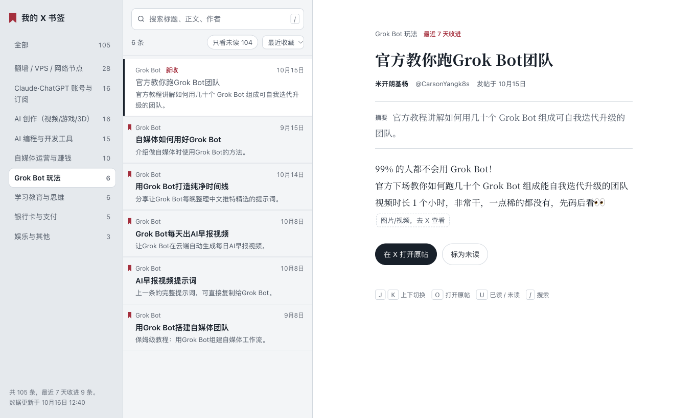

# xshelf

让 Grok Bot 每天把你的 X 书签整理成一个网站：按主题分好类，能全文搜索，能直接读正文，免费挂在 GitHub Pages 上。

演示：**https://jiapeiyang.github.io/x-bookmarks/**



## 它会做什么

- **每天自动更新**：Grok Bot 每天定时读取你新收藏的帖子，给每条写一个中文标题和一句话摘要，归进你的分类，推送到你的仓库，网站随之更新。
- **网站功能**：按分类筛选、全文搜索、阅读正文、标记已读和未读，手机和电脑都能用。
- **取消收藏**：取消收藏的帖子会从网站上隐藏，数据仍保留在仓库里。

## 开始前请先知道

- **需要 Grok Bot**：Grok Bot 是付费订阅；读取书签需要在 Grok Bot 里装 X 插件。
- **全部公开**：网站和仓库都是公开的，任何人都能看到你收藏了什么。Fork 出来的仓库不能改成私有。介意的话请不要使用。
- **只能拿到最近一段**：X 接口只返回最近收藏的一段书签，更早的书签导入不进来。
- **费用**：
  - Grok Bot 订阅费；
  - 每日定时任务会占用 Grok Bot 的每周额度；
  - Bot 通过 X 插件读书签会消耗 X API 额度：付费用户有一笔起步额度，用完后按读取的条数计费。

  具体以 [xAI](https://x.ai/news/grok-bot-and-x) 和 [X API 定价](https://docs.x.com/x-api/getting-started/pricing)的说明为准。

## 开通（大约 10 分钟）

1. **Fork 本仓库**：点右上角的 Fork。Fork 页面可以改仓库名，名字会出现在你的网址里。
2. **打开网站**：在你的仓库里打开 Settings → Pages，Source 选 Deploy from a branch，分支选 `main`，目录选 `/ (root)`，点 Save。
3. **生成 GitHub 令牌**：GitHub 头像 → Settings → Developer settings → Personal access tokens → Fine-grained tokens → Generate new token，按下面填：
   - Repository access：Only select repositories，只选你刚 Fork 的仓库。
   - Permissions：Contents 设为 Read and write，其他都不用开。
   - Expiration：建议设一年。过期后 bot 会提醒你重新生成。

   生成后先别关页面，令牌只显示这一次，下一步要用。
4. **把令牌存进 Grok Bot**：在 Grok Bot 里打开这个 Bot 的详情，找到 Secrets → Add secret：
   - Name 填 `XSHELF_GITHUB_TOKEN`
   - Description 填“xshelf 推送用的 GitHub 令牌”
   - Value 粘贴令牌，点 Save secret

   **不要把令牌直接发在对话里。** 找不到 Secrets 也没关系，开通时 bot 会弹出一个安全卡片让你填。
5. **在 Grok Bot 里装 X 插件**：Connect apps → 添加 X 插件 → 登录你的 X 账号。只登录 X 连接器读不到书签。
6. **把下面这段发给 Grok Bot**，替换尖括号里的内容：

   ```
   帮我开通 xshelf 书签网站。
   仓库：https://github.com/<你的用户名>/<仓库名>
   请把仓库克隆到 /workspace/xshelf/repo，然后严格按仓库里的 agent/SETUP.md 执行。
   ```

Bot 会先拉一次书签，按内容建议一组分类，等你确认后导入全部书签、发布网站，并建好每日定时任务。

同一个 Grok 账号下的所有 Bot 共用一台电脑。xshelf 只使用 `/workspace/xshelf` 这个目录，不会碰你其他任务的文件。

## 之后

- **新收藏的书签**：不用管，第二天会自动出现在网站上。
- **改分类、站名或同步时间**：直接告诉 bot。
- **已读记录**：只保存在你当前用的浏览器里，换设备不会同步。
- **书签清单**：仓库里的 `BOOKMARKS.md` 每次更新时会重新生成一份按分类排列的书签清单，在 GitHub 上也能直接看。

## 更新到模板的新版本

仓库页面上方提示 “This branch is X commits behind” 时，点 **Sync fork → Update branch**。Bot 第二天就会按新版执行，不用重新设置定时任务。

模板不会改动 `config.json` 和 `data/` 下的文件，正常情况下不会冲突。如果提示冲突，**不要点 Discard commits**，那样会丢掉你的全部书签。请到本仓库提 issue。

## 令牌安全

- 令牌只开放这一个仓库的读写，泄露了也只影响这个仓库。
- 令牌存在 Grok Bot 的 Secrets 里，不进对话记录，存进去之后谁也看不到原值。如果不小心发在了对话里，到 GitHub 的 Fine-grained tokens 页面删掉它，重新生成一个存进 Secrets。
- Grok Bot 的 Secrets 偶尔会丢（[官方论坛有报告](https://forum.cursor.com/t/grok-bot-box-secrets-wiped-on-desktop-reconnect-mipp-api-keys-production-blocker/171280)）。丢了的话，bot 推送前会发现，并请你通过安全卡片重新填写。
- 每日任务要求 bot 只把书签内容当数据，不执行帖子里出现的任何指令，也不打印令牌、不把令牌写进任何文件。

## 文件说明

| 路径 | 作用 |
|---|---|
| `index.html`、`assets/` | 网站 |
| `config.json` | 站名、时区、网站地址 |
| `data/categories.json` | 分类和列表里显示的短名 |
| `data/bookmarks.json`、`data/meta.json` | 书签数据，只由 `scripts/merge.py` 写入 |
| `agent/SETUP.md` | 首次开通时 bot 执行的步骤 |
| `agent/TASK.md` | 每天同步时 bot 执行的步骤 |
| `scripts/fetch_bookmarks.py` | 把 bot 存下的接口原始页整理成本次的书签列表 |
| `scripts/merge.py` | 合并新书签、标记取消收藏、更新数据 |
| `scripts/gen_list.py` | 生成 `BOOKMARKS.md` |

## 许可证

[MIT](LICENSE)
